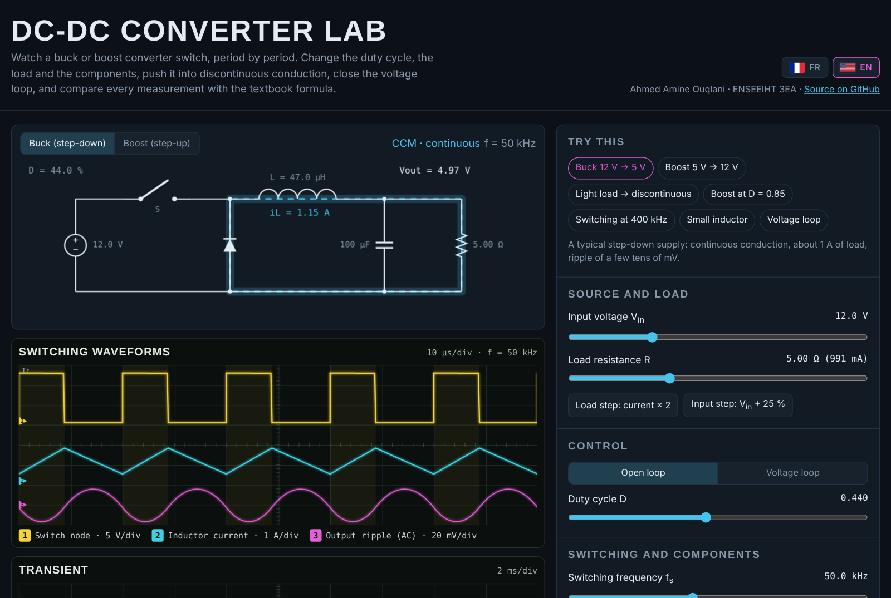

# DC-DC Converter Lab


**Live demo: https://amine-ouqlani.github.io/dc-dc-converter-lab/** · in English and French (flag buttons at the top
right, or add `?lang=fr` to the address)

An interactive simulator of the two basic DC-DC converters, **buck** (step-down) and **boost** (step-up). You watch them
switch period by period on an oscilloscope, change the duty cycle, the load and the components, push them into
discontinuous conduction, close a voltage control loop, and compare every measurement with the textbook formula.

It covers the static power conversion of the first-year program of the 3EA department of ENSEEIHT (electronics,
electrical energy and automatic control).



## What it shows

- **Oscilloscope view**: switch-node voltage, inductor current and output ripple, triggered on the switch turn-on,
  with real V/div and µs/div scales.
- **Animated schematic**: in slow motion (2 periods per second) you see the current path change between the switch
  ON phase, the diode phase, and the zero-current phase of discontinuous conduction.
- **Theory vs simulation table**: output voltage, current ripple, voltage ripple, conduction mode and efficiency, next
  to the ideal formula and the formula with losses.
- **Where the power goes**: output power and each loss (switch conduction, switching, diode, inductor).
- **Static characteristic**: Vout/Vin as a function of D, ideal, with losses (the boost curve peaks and falls back at
  high duty cycle) and in discontinuous mode, with the simulated operating point.
- **Voltage loop**: integral control with feed-forward; load step and input step buttons to see it react.

## Try this

| Preset | What to look at |
|---|---|
| Light load → discontinuous | i<sub>L</sub> touches zero every period and Vout rises above D·Vin |
| Boost at D = 0.85 | the ideal formula promises 33 V; losses bring it to 28 V (simulation and loss formula agree to 0.02 %) |
| Switching at 400 kHz | current ripple ÷ 8, voltage ripple ÷ 64, switching losses × 8 |
| Small inductor | discontinuous conduction even at full load |
| Voltage loop | press *Load step*: the output dips, then the integral brings it back to 5.000 V |

## The model

Each switching period is split into an ON phase (D·Ts) and an OFF phase, each integrated in 400 small RK4 steps, so the
switching instants are exact.

```
BUCK   ON : L·diL/dt = Vin − (Ron + rL)·iL − vC
       OFF: L·diL/dt = −VF − rL·iL − vC           (diode conducts while iL > 0)
       C·dvC/dt = iL − vC/R
BOOST  ON : L·diL/dt = Vin − (Ron + rL)·iL ,       C·dvC/dt = −vC/R
       OFF: L·diL/dt = Vin − rL·iL − VF − vC ,     C·dvC/dt = iL − vC/R
```

When the diode would have to carry a negative current it blocks: i<sub>L</sub> stays at zero until the next ON phase
(discontinuous conduction). Conduction losses come out of the simulation; switching losses use E = ½·V·I·t<sub>sw</sub>
at each turn-on and turn-off.

### Formulas it is checked against

| | Buck | Boost |
|---|---|---|
| Ideal ratio (CCM) | D | 1 / (1 − D) |
| Current ripple | (Vin − Vout)·D / (L·fs) | Vin·D / (L·fs) |
| Voltage ripple | ΔiL / (8·C·fs) | Iout·D / (C·fs) |
| DCM when K = 2L·fs/R < | 1 − D | D(1 − D)² |
| Ideal ratio (DCM) | 2 / (1 + √(1 + 4K/D²)) | (1 + √(1 + 4D²/K)) / 2 |

### Voltage loop

Once per period, `D = D_ff + Ki·∫(Vref − Vout)`. The feed-forward D_ff comes from the conversion ratio (solved in
whichever conduction mode applies). Ki is tuned automatically from the circuit:

- in continuous conduction, the crossover is placed below the LC resonance with 6 dB of margin at the resonant peak,
  below the boost right-half-plane zero (ω_z / 5) and well below the switching frequency (2π·fs / 20);
- in discontinuous conduction, the plant has a single pole ω_p = (2 − M)/((1 − M)·R·C) for the buck and
  (2M − 1)/((M − 1)·R·C) for the boost, and the crossover follows it.

The *Loop speed* slider multiplies that crossover: above ×1 the margin shrinks and the loop starts to ring.

## Tests

`node tests/run-tests.js` (needs Node.js; also runs automatically on GitHub at every push). 20 checks, 10 per
converter:

- ideal output voltage, current ripple and voltage ripple against the formulas;
- discontinuous mode: the DCM formula, and the CCM/DCM boundary K = K<sub>crit</sub>;
- output voltage with losses against the analytic formula, and the energy balance Pin = Pout + losses;
- higher switching frequency: less ripple, more switching losses;
- closed loop: holds Vref through a load step and an input step;
- automatic tuning: stable on a grid of 16 combinations of L, C, R and fs.

## Project structure

```
index.html          page
css/style.css       styles (dark and light themes, oscilloscope screens)
js/converter.js     simulation, losses, textbook formulas, loop tuning
js/presets.js       "Try this" situations (EN + FR)
js/i18n.js          English and French interface texts
js/app.js           schematic, oscilloscopes, plots and controls
tests/run-tests.js  automated checks against the theory
```

No framework and no build step: plain HTML, CSS and JavaScript. Open `index.html` in a browser to run it locally.

## En français

Simulateur interactif des hacheurs série (buck) et parallèle (boost) : formes d'onde sur un oscilloscope, conduction
continue et discontinue, pertes et rendement, boucle de tension, et comparaison de chaque mesure avec la formule du
cours. Bouton FR en haut à droite, ou `?lang=fr` dans l'adresse.

## Author

Ahmed Amine Ouqlani, engineering student at ENSEEIHT (Toulouse INP), 3EA department.
[Portfolio](https://amine-ouqlani.github.io) · [Drone Attitude Lab](https://amine-ouqlani.github.io/drone-attitude-sim/)

MIT License.
